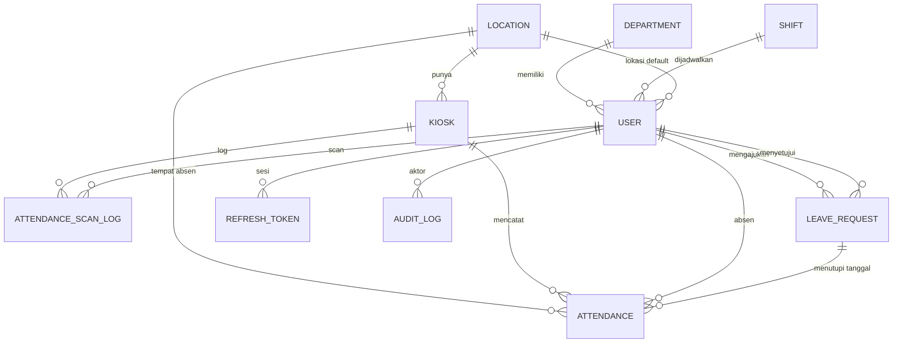

# Database — AbsenYok (MySQL 8)

Sumber kebenaran: `backend/prisma/schema.prisma` (Prisma ORM v7, sudah tervalidasi).
Charset: `utf8mb4` / `utf8mb4_unicode_ci`. Zona waktu server DB: UTC.

## ERD

## Ringkasan Tabel

| Tabel | Fungsi | Catatan penting |
|---|---|---|
| `users` | Akun semua role | `employeeCode` & `email` unik; soft delete `deletedAt`; `boundDeviceId` untuk device binding; `failedLoginAttempts` + `lockedUntil` untuk lockout |
| `departments` | Divisi/bagian | `code` & `name` unik |
| `shifts` | Jam kerja | `startTime`/`endTime` format `HH:mm`; `workDays` CSV ISO weekday |
| `locations` | Kantor + geofence | `latitude`/`longitude` Decimal(10,7), `radiusMeters` |
| `kiosks` | Layar penampil QR | `secret` hanya di server; `lastSeenAt` diperbarui saat polling QR |
| `attendances` | 1 baris per user per tanggal | `@@unique([userId, date])`; `shiftSnapshot` membekukan aturan shift saat itu |
| `attendance_scan_logs` | Semua percobaan scan | untuk audit kecurangan & debugging |
| `leave_requests` | Izin/sakit/cuti | `totalDays` = hari kerja |
| `holidays` | Libur nasional/kantor | `date` unik |
| `refresh_tokens` | Sesi login | simpan **hash SHA-256**, `familyId` untuk deteksi reuse |
| `audit_logs` | Jejak aktivitas sensitif | `metadata` JSON berisi before/after |
| `settings` | Key-value konfigurasi | lihat daftar key di bawah |

## Key `settings` Bawaan (diisi seed)
| key | contoh value |
|---|---|
| `company.name` | `PT AbsenYok Indonesia` |
| `company.logoUrl` | `` |
| `attendance.geofenceEnabled` | `true` |
| `attendance.deviceBindingEnabled` | `true` |
| `attendance.minCheckoutGapMinutes` | `5` |
| `leave.annualQuota` | `12` |
| `leave.maxRangeDays` | `14` |

Nilai di tabel `settings` **menimpa** nilai env (env = default awal).

## Data Seed
- 1 SUPER_ADMIN, 1 ADMIN, 10 EMPLOYEE (nama Indonesia realistis via @faker-js/faker locale `id_ID`)
- 3 departemen: `IT` (Teknologi Informasi), `HR` (Sumber Daya Manusia), `FIN` (Keuangan)
- 2 shift: `Reguler` 08:00–17:00 (Sen–Jum), `Pagi Sabtu` 08:00–13:00 (Sen–Sab)
- 1 lokasi: Kantor Pusat (contoh: -6.2000000, 106.8166667, radius 100 m)
- 1 kiosk: "Lobi Utama"
- Hari libur nasional tahun berjalan (beberapa contoh)
- Absensi 30 hari terakhir untuk karyawan contoh (campuran PRESENT/LATE/ABSENT/SICK) agar dashboard langsung terisi

## Index & Performa
- Laporan bulanan memakai `attendances(date, status)` dan `@@unique(userId, date)`.
- Rekap per karyawan: query `WHERE userId = ? AND date BETWEEN ? AND ?` memanfaatkan unique index komposit.
- Hindari N+1: gunakan `include`/`select` terarah, dan `groupBy` Prisma untuk statistik.
